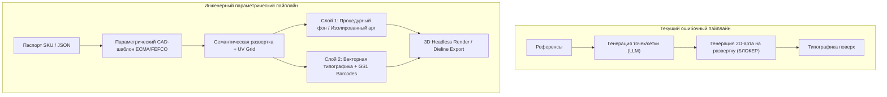
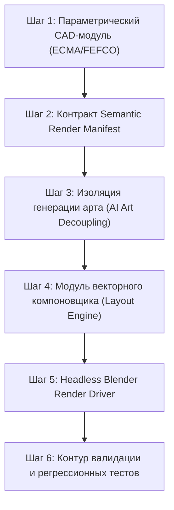

# ТЕХНИЧЕСКИЙ АУДИТ И АРХИТЕКТУРНЫЙ ОТЧЕТ
## Генеративный пайплайн разработки упаковки (Generative Packaging Pipeline)
**Автор:** Lead Systems Architect / Senior Technical Art Director (Generative Packaging & 3D/2D Pipelines)  
**Проект:** Blender Farm Pro (Headless 3D/2D CAD & Generative Packaging Pipeline)  
**Дата аудита:** Август 2026  
**Версия документа:** v1.0-FINAL  

---

## 1. АРХИТЕКТУРНЫЙ АУДИТ ТЕКУЩЕГО ПОДХОДА

### 1.1. Оценка жизнеспособности метода: «Референсы → Построение по точкам → Дизайн поверх → Типографика»

Текущий линейный подход:
1. Анализ входных референсов (через мультимодальную LLM / Claude).
2. Построение геометрии/развертки по точкам (Point-by-point vertex/mesh reconstruction).
3. Генерация и наложение графического дизайна (2D Diffusion/Neural Inpainting на полученную развертку).
4. Наложение типографики и финальный продакшн-лейаут.

**Инженерный вердикт:** Метод в своей основе содержит критическую архитектурную ошибку — попытку решить задачу конструкционного промышленного дизайна методами органического 3D-моделирования и неконтролируемой 2D-диффузии. В текущем виде данный подход **нежизнеспособен** для промышленного производства, тиражирования и создания воспроизводимых каталогов упаковки.

#### Причины несостоятельности:
- **Упаковка как листовой материал, а не произвольный 3D-меш:** В реальном мире картонная упаковка (folding carton) не создается произвольным набором вершин в 3D. Она подчиняется строгой топологии плоской штанцформы (dieline), определяемой стандартами **ECMA** (для складных коробок из картона) и **FEFCO** (для гофрокартона).
- **Иллюзия гибкости нейросетевого построения по точкам:** Попытка заставить LLM генерировать массивы координат `[x, y, z]` по фотореференсу неизбежно порождает непланарные полигоны (non-planar quads), нарушенные нормали, самопересечения геометрии и неразворачиваемые в плоскость поверхности.
- **Разрыв причинно-следственных связей:** В промышленном дизайне форма определяет технологическую развертку (dieline), развертка определяет параметрические UV-координаты и семантические зоны (лицевая панель, боковины, клапаны склейки, пылевые клапаны), а дизайн создается строго внутри этих семантических границ с учетом технологических вылетов (bleed) и безопасных полей (safe margins). Текущий пайплайн пытается инвертировать этот процесс.



---

### 1.2. Фундаментальные риски разделения формы и дизайна на изолированные этапы

Разделение процесса на два изолированных "черных ящика" (Сначала изолированно генерируем 3D-форму -> затем изолированно пытаемся сгенерировать 2D-дизайн и натянуть его) порождает системный кризис согласованности данных:

1. **Разрыв контекста (Context Gap):**
   Генератор 2D-дизайна (диффузионная модель) оперирует растровым холстом. Он не имеет представления о том, что:
   - Левый край изображения будет согнут под 90° и должен сойтись с правым краем другой панели.
   - Верхняя часть развертки — это откидной клапан, который в сложенном состоянии физически развернут на 180° относительно взгляда зрителя.
   - Боковой сегмент шириной 12 мм — это клеевой клапан (glue tab), на котором нанесение краски строго запрещено (иначе адгезия водно-дисперсионного или термоклеевого состава упадет до нуля, и коробка расклеится на фальцевально-склеивающей линии).
2. **Отсутствие замкнутого контура обратной связи (No Validation Loop):**
   При изолированном пайплайне ошибки геометрии (например, асимметрия клапанов на 0.5 мм) не детектируются на этапе дизайна. Они проявляются только на этапе финального 3D-рендеринга или пробного вывода, когда исправить геометрию без полного разрушения и перегенерации 2D-арта уже невозможно.
3. **Двойная стохастичность (Compounding Errors):**
   Вероятность успешного исхода всей цепочки равна произведению вероятностей каждого стохастического шага:
   P_success = P_geo * P_design * P_mapping * P_typo
   Если каждый шаг на базе нейросетевых генераций успешен с вероятностью 70%, то общий выход годного продукта составляет:
   0.7 * 0.7 * 0.7 * 0.7 ≈ 24%
   Это неприемлемо для коммерческого конвейера.

---

### 1.3. Анализ метода построения по точкам в контексте промышленного дизайна

Метод формирования геометрии через генерацию точек LLM ведет к фатальному накоплению геометрических и текстурных погрешностей:

| Вид дефекта | Физическая/Математическая причина | Последствия в продакшене и 3D-рендере |
| :--- | :--- | :--- |
| **Дрейф масштаба (Scale Drift)** | Отсутствие жесткой метрической привязки (World Units). LLM оперирует относительными или приблизительными пропорциями. | Коробка с реальными размерами 120 x 60 x 30 мм превращается в 118.4 x 64.1 x 28.9 мм. Разрушение стандартизированных рядов упаковки. |
| **Искажение текстур (Texel Density Mismatch)** | Автоматическая триангуляция и проекция неравномерных полигонов. | На лицевой панели плотность пикселей составляет 400 DPI, на боковых — 150 DPI. Текст и мелкие детали становятся размытыми. |
| **Коллизии и разрывы UV (UV Seam Tearing)** | Сшивка несмежных UV-островов без субпиксельного выравнивания. | На ребрах коробки возникают черные артефакты, разрывы линий, смещение графических паттернов на стыках. |
| **Игнорирование толщины картона (Caliper & Bending Allowance)** | Построение коробки как математической поверхности нулевой толщины (t=0). | При попытке согнуть развертку в 3D грани пересекают друг друга (Z-fighting / self-intersection), а замки не попадают в пазы. |

---

## 2. ДЕКОНСТРУКЦИЯ ПРОБЛЕМЫ ЭТАПА «ДИЗАЙН»

### 2.1. Причины блокировки на этапе наложения графики

Застревание на этапе 3 — закономерный системный тупик, вызванный архитектурным несоответствием инструмента поставленной задаче:

1. **Архитектурный перекос диффузионных моделей:**
   Современные генеративные 2D-модели (Stable Diffusion, Midjourney, Flux, DALL-E) обучены на корпусах естественных изображений в прямой или перспективной проекции. Они обладают латентным представлением о композиции «предмет в кадре», но не имеют латентного представления о топологии ортогональных разверток штанцформ. Для нейросети развертка — это абстрактный коллаж из прямоугольников, который она пытается заполнить как единую картину.
2. **Пространственная дезориентация локальных координат:**
   На плоской развертке коробки верхний клапан ориентирован вектором «вверх» в направлении +Y, а противоположный клапан дна в развернутом виде может требовать ориентации текста в -Y (перевернут на 180°), чтобы после сборки коробки оба текста читались правильно. Модели генерации изображений не имеют механизма понимания локальных осей координат (Local Transform Space) отдельных полигональных регионов.

```
+-------------------------------------------------------------------------------+
|                             ТОПОЛОГИЧЕСКИЙ РАЗРЫВ                             |
|                                                                               |
|   Развертка (2D Layout)                      Собранная коробка (3D View)      |
|   +---------------+ +---------------+        +---------------+                |
|   | Panel A       | | Panel B       |   ==>  | Panel A | P.B | (Стык под 90°) |
|   | (UV Island 1) | | (UV Island 2) |        |         |     |                |
|   |   [ Паттерн ] | | [ Паттерн ? ] |        | Градиент РАЗОРВАН на ребре!    |
|   +---------------+ +---------------+        +---------------+                |
+-------------------------------------------------------------------------------+
```

---

### 2.2. Проблема переноса 2D-генераций на геометрию разверток

- **Топологическая нелокальность в 2D:** В развертке смежные в пространстве грани (например, боковая панель и боковой клапан крышки) часто физически разделены компенсационными прорезями (notches) или разнесены на разные участки листа раскроя. 2D-диффузия не в состоянии обеспечить непрерывность векторных кривых и градиентов через эти разрывы.
- **Проекционные артефакты при трипланарном или камерном маппинге:** Попытка спроецировать сгенерированный 2D-арт с камеры на 3D-модель (Camera Projection) дает идеальную картинку только строго под углом съемки. На гранях, расположенных под острым углом к лучу камеры (70°–90°), происходит катастрофическое растяжение пикселей (texture stretching), а тыльные стороны остаются неотекстурированными.

---

### 2.3. Недостающие звенья данных между этапом 2 и этапом 3

Для успешной передачи данных от формы к дизайну в системе **критически отсутствуют следующие сущности**:

```json
{
  "$schema": "https://json-schema.org/draft/2020-12/schema",
  "title": "Missing_Data_Link_Contract",
  "required_entities": [
    "Semantic_Panel_Registry",
    "Orientation_Vectors_Map",
    "Bleed_And_Safe_Zones",
    "Technical_Exclusion_Masks"
  ]
}
```

1. **Реестр семантических панелей (Semantic Panel Registry):** Машиночитаемая разметка каждого полигона развертки с присвоением роли: `front_face`, `rear_face`, `left_spine`, `right_spine`, `top_cap`, `bottom_cap`, `glue_flap`, `dust_flap_left`, `dust_flap_right`.
2. **Карта локальных векторов ориентации (Orientation Vectors Map):** Четкое определение вектора V_up и угла поворота (0°, 90°, 180°, 270°) для каждой панели.
3. **Технологические слои ограничений (Constraint Layers):**
   - *Bleed Mask (Вылеты под обрез):* Зона расширения фона на 3.0–5.0 мм за пределы реза.
   - *Safe Zone Mask (Зона безопасности):* Внутренний отступ 3.0–4.0 мм от линий биговки и реза, за пределы которого запрещено выносить текст и логотипы.
   - *Glue/Non-Print Mask (Зоны без печати):* Клапаны склейки и технические поля, исключаемые из генерации.

---

## 3. АЛЬТЕРНАТИВНЫЕ И ПАРАЛЛЕЛЬНЫЕ ПАЙПЛАЙНЫ

Вместо попытки монолитной генерации «дизайна целиком» необходимо перейти к компонентной архитектуре.

### Сценарий A: Parametric Vector/SVG Layout Engine (Рекомендуемый стандарт)
- **Архитектура:** Форма коробки берется из библиотеки параметрических CAD-шаблонов (ECMA A20/B10 и др.) по габаритам W x H x D. Развертка генерируется кодом в виде SVG/PDF документа с идеальной математической точностью. Графический дизайн формируется программно: процедурные векторные паттерны + сгенерированные AI растровые иллюстрации (изолированные объекты с альфа-каналом) + векторный типографический слой.
- **Интеграция с 3D:** Готовый многослойный SVG растрируется в высоком разрешении (4096 x 4096 или 8192 x 8192) и накладывается на фиксированный UV-каркас в Blender.
- **Преимущества:** 100% геометрическая точность, отсутствие артефактов на стыках, полная готовность к полиграфическому производству (Dieline + CMYK PDF).

### Сценарий B: Multi-Panel Masked ControlNet Pipeline (Нейросетевой с жестким контролем)
- **Архитектура:** Дизайн генерируется не на всю развертку сразу, а поканально/попанельно. Генератор получает ортогональную маску конкретной панели с заданными пропорциями и генерирует арт с использованием ControlNet (LineArt / Depth / Canny) по границам панели.
- **Сшивка швов (Seamless Seam Synthesis):** Для непрерывных паттернов применяется двухпроходный рендеринг: базовый арт наносится на 3D-модель, угол коробки рендерится в высоком разрешении, зона стыка отправляется на Inpainting с сохранением непрерывности, затем текстура запекается (bake) обратно в текстурную карту развертки.
- **Преимущества:** Высокая художественная вариативность нейросетевой графики при контролируемом совмещении граней.

### Сценарий C: Hybrid Shader + Decals Architecture (Архитектура Blender Farm Pro)
- **Архитектура:** Геометрия коробки строится процедурно через Blender Geometry Nodes. Материалы упаковки создаются процедурными шейдерами (текстура матового/глянцевого картона, металлизированный слой, выборочный UV-лак, фольгирование). Графика наносится слоями декалей (Decal layers) с локальным маппингом. Типографика строится нативными сплайнами/кривыми (`bpy.data.curves`) или динамическими оверлеями.
- **Преимущества:** Кинематографическое качество 3D-рендеринга, полное разделение визуальных эффектов (лак, конгрев, тиснение), невозможность галлюцинации текста.

---

### Сравнительная таблица методов

| Критерий | 1. Текущий подход (Точки + 2D Diffuse) | Сценарий A (Parametric SVG Engine) | Сценарий B (Multi-Panel ControlNet) | Сценарий C (Hybrid Shader + Decals) |
| :--- | :--- | :--- | :--- | :--- |
| **Сложность реализации** | Высокая (нестабилен) | Средняя (детерминирован) | Очень высокая | Средняя |
| **Контроль геометрии** | ❌ Критически низкий | ✔ Абсолютный (CAD) | ⚠️ Ограниченный UV | ✔ Абсолютный (3D Nodes) |
| **Качество стыковки граней**| ❌ Артефакты и разрывы | ✔ Идеальное (вектор) | ⚠️ Зависит от запекания | ✔ Идеальное (3D mapping) |
| **Читаемость типографики** | ❌ Галлюцинации, размытие | ✔ 100% векторная четкость | ❌ Непригодно для текста | ✔ Идеальная (3D Geometry) |
| **Степень автоматизации** | Низкая (требует ручной правки)| ✔ 100% автономный конвейер | ⚠️ Требует модерации QC | ✔ 100% автономный |
| **Готовность к препрессу (Print)**| ❌ Полностью непригоден | ✔ 100% (PDF/X-1a, CMYK) | ❌ Требует полной перерисовки | ⚠️ Только для рендеров |

---

## 4. ПЛАН ПЕРЕХОДА К ЭТАПУ «ТИПОГРАФИКА»

В промышленной (особенно фармацевтической) упаковке типографика и маркировка строго регламентированы законодательством и стандартами (FDA, EMA, ГОСТ, GS1). Текст несёт юридическую и медицинскую ответственность: ошибки в дозировке, названии действующего вещества или штрихкоде недопустимы.

```
+------------------------------------------------------------------------------------+
| СИСТЕМА СЛОЕВ И БЕЗОПАСНЫХ ЗОН (LAYER & GRID ARCHITECTURE)                         |
|                                                                                    |
| + - - - - - - - - - - - - - - - - - - - - - - - - - - - - - - - - - - - - - - -  + |
| ' BLEED ZONE: Вылет под обрез (+3.0 мм наружу от линии штанцформы)               ' |
| '  +--------------------------------------------------------------------------+  ' |
| '  | DIE-CUT LINE: Линия физического ножа штанцформы (Cut Contour)            |  ' |
| '  |  + - - - - - - - - - - - - - - - - - - - - - - - - - - - - - - - - - -+  |  ' |
| '  |  ' SAFE ZONE: Безопасное поле (Отступ -3.5 мм вовнутрь)               '  |  ' |
| '  |  '   ┌────────────────────────────────────────────────────────────┐   '  |  ' |
| '  |  '   │ [BRAND NAME]                     [DOSAGE / STRENGTH]       │   '  |  ' |
| '  |  '   │ Якорная привязка: Top-Left       Якорная привязка: Top-Right│   '  |  ' |
| '  |  '   │                                                            │   '  |  ' |
| '  |  '   │ [ACTIVE SUBSTANCE]                                         │   '  |  ' |
| '  |  '   │ Baseline Offset: 12 mm                                     │   '  |  ' |
| '  |  '   │                                                            │   '  |  ' |
| '  |  '   │ [BARCODE GS1 EAN-13]             [DATAMATRIX / 2D CODE]    │   '  |  ' |
| '  |  '   │ Белая подложка + Quiet Zone      100% Black / Векторный    │   '  |  ' |
| '  |  '   └────────────────────────────────────────────────────────────┘   '  |  ' |
| '  |  + - - - - - - - - - - - - - - - - - - - - - - - - - - - - - - - - - -+  |  ' |
| '  +--------------------------------------------------------------------------+  ' |
| + - - - - - - - - - - - - - - - - - - - - - - - - - - - - - - - - - - - - - - -  + |
+------------------------------------------------------------------------------------+
```

### 4.1. Разделение слоев (Layer Isolation Invariant)
В пайплайне на уровне кода закрепляется строгое разделение на 4 изолированных слоя:
1. **Слой 0: Dieline (Технический):** Векторные контуры реза (Cut — Spot Cyan), биговки (Crease — Spot Magenta) и перфорации. Слой никогда не запекается в цветную печать, но используется как ограничивающий контур.
2. **Слой 1: Background & Bleed (Фоновый):** Процедурные градиенты, текстуры, фоновые паттерны. Обязан заполнять всю площадь с вылетом за пределы линии реза минимум на 3.0–5.0 мм.
3. **Слой 2: Brand & Graphic Assets (Иллюстративный):** Изолированные графические элементы (логотипы, бренд-графика, 3D-рендеры действующего вещества/органов-мишеней), спозиционированные внутри безопасных полей.
4. **Слой 3: Production Typography & Barcodes (Регуляторный):** Векторный текст, таблицы состава, штрихкоды, знаки сертификации. **Абсолютный запрет на растрирование через нейросети.**

---

### 4.2. Модульная сетка и якорное позиционирование (Grid & Anchors)

Позиционирование элементов на каждой грани описывается математически через систему нормализованных якорей:
- X_pos = X_panel_origin + Margin_left + delta_x
- Y_pos = Y_panel_origin + Margin_top + delta_y

- **Правило безопасных полей (Safe Margins):** Ни один текстовый или знаковый элемент не может находиться ближе 3.5 мм к линии биговки или реза во избежание срезания или залома при фальцовке.
- **Правило светлого поля штрихкодов (GS1 Quiet Zone):** Вокруг штрихкодов EAN-13 и DataMatrix автоматически генерируется непрозрачная подложка с отступом не менее 2.5 мм (Quiet Zone) для обеспечения 100% считываемости сканерами.
- **Генерация кодов:** Штрихкоды и DataMatrix генерируются специализированными детерминированными библиотеками (`python-barcode`, `treepoem`, `pylibdmtx`) строго в векторном формате.

---

### 4.3. Рендеринг типографики в 3D (Blender Packshot Pipeline)

Для создания пакшотов фотографического качества типографика выводится одним из двух методов:
- **Метод 1: Нативная 3D-геометрия (Текстовые кривые Blender):** Текст генерируется через `bpy.data.curves` с привязкой проверенных шрифтов из локального каталога (`05_assets/blender/fonts/`). Задается микро-экструзия (0.02–0.05 мм) и фаска (0.01 мм). Это позволяет физически корректно симулировать тиснение (embossing/debossing), фольгирование и трафаретный УФ-лак через Cycles/EEVEE.
- **Метод 2: High-Res Dynamic Alpha Overlay:** Векторная разметка рендерится в текстурный атлас 8192 x 8192 px (RGBA, 32-bit float) и подключается в шейдере Blender через ноду `Mix Shader` как фактор смешивания между базовым картоном и глянцевой краской/лаком.

---

## 5. ИТОГОВЫЙ ВЕРДИКТ И РАЗВЕРНУТЫЙ ПОШАГОВЫЙ ПЛАН ПЕРЕХОДА

### Резюме аудита
> **ИТОГОВЫЙ ВЕРДИКТ: ПОЛНАЯ АРХИТЕКТУРНАЯ ПЕРЕСТРОЙКА.**  
> Попытка развивать текущий подход («докрутка промптов Claude для точек геометрии» + «натягивание 2D диффузии на нерегулярный меш») является тупиковой. Она создает иллюзию прогресса на простых кубических формах, но мгновенно разрушается при переходе к реальным разверткам, нестандартным замкам, тиснению и нормативной типографике.  
> 
> **Решение:** Переход на **детерминированную параметрическую платформу (Parametric CAD Core + Semantic Layout Engine + Headless 3D Render)**.

---

### РАЗВЕРНУТЫЙ ПОШАГОВЫЙ ПЛАН РЕАЛИЗАЦИИ (ACTION PLAN)



---

### ШАГ 1. Создание параметрического CAD-модуля разверток (Parametric Dieline Engine)

#### 1.1. Суть задачи:
Полностью исключить нейросетевую генерацию вершин и полигонов. Заменить её на детерминированный математический модуль на Python, строящий 2D-штанцформу и соответствующий 3D-меш по стандартизированным инженерным каталогам.

#### 1.2. Техническая реализация:
1. Создать модуль `src/dieline_generator.py`.
2. Реализовать параметрические формулы для базовых упаковочных типов:
   - **ECMA A20.20.03.01** (Стандартная пачка с продольным клеевым швом и встречными замковыми клапанами).
   - **ECMA A20.20.03.02** (Пачка со смежными клапанами).
   - **ECMA B10** (Упаковки типа «пенал / слив-бокс»).
3. Входные параметры функции:
   Params = { W (ширина), H (высота), D (глубина), t (толщина картона/caliper), glue_tab_width }
4. Расчет координат развертки в миллиметрах с добавлением компенсаций на сгибы:
   W_panel_adjusted = W + k * t  (k ≈ 0.5–0.8)
5. Автоматическая генерация двух проекций:
   - **2D Vector Dieline** (экспорт в DXF / SVG для производства и текстурирования).
   - **3D Manifold Quad Mesh** (с нулевым искажением UV и назначенными материалами граней).

#### 1.3. Критерии приемки (DoD):
- Погрешность размеров геометрии: 0.00 мм (математическое совпадение).
- Сетка меша состоит на 100% из планарных четырехугольников (quads), нормали ориентированы строго наружу.
- UV-развертка создается автоматически, занимает 100% полезного пространства текстурного атласа без наложений (zero overlap) и сохраняет одинаковую плотность пикселей по всем осям.

---

### ШАГ 2. Разработка контракта семантического манифеста (Semantic Render Manifest)

#### 2.1. Суть задачи:
Создать строгий единый контракт данных между генератором структуры данных (Stage 1) и визуализатором/сборщиком (Stage 2). Любая попытка передачи невалидированных данных должна блокироваться схемой.

#### 2.2. Техническая реализация:
1. Создать JSON-схему `schemas/render_manifest.schema.json`.
2. Описать интерфейс разметки для каждой грани упаковки:
   ```json
   {
     "$schema": "https://json-schema.org/draft/2020-12/schema",
     "title": "RenderManifest",
     "type": "object",
     "required": ["sku_id", "geometry", "panels", "typography", "palette"],
     "properties": {
       "sku_id": { "type": "string" },
       "geometry": {
         "template_type": { "type": "string", "enum": ["ECMA_A20", "ECMA_B10"] },
         "dimensions_mm": {
           "type": "object",
           "required": ["width", "height", "depth", "caliper"],
           "properties": {
             "width": { "type": "number" },
             "height": { "type": "number" },
             "depth": { "type": "number" },
             "caliper": { "type": "number", "default": 0.4 }
           }
         }
       },
       "panels": {
         "type": "object",
         "required": ["front", "rear", "left", "right", "top", "bottom"],
         "additionalProperties": {
           "type": "object",
           "required": ["uv_bounds", "orientation_deg", "safe_margin_mm"],
           "properties": {
             "uv_bounds": {
               "type": "array",
               "items": { "type": "number" },
               "minItems": 4,
               "maxItems": 4
             },
             "orientation_deg": { "type": "integer", "enum": [0, 90, 180, 270] },
             "safe_margin_mm": { "type": "number" },
             "bleed_margin_mm": { "type": "number" }
           }
         }
       },
       "typography": {
         "type": "object",
         "required": ["brand_name", "generic_name", "dosage", "form_factor"],
         "properties": {
           "brand_name": { "type": "string" },
           "generic_name": { "type": "string" },
           "dosage": { "type": "string" },
           "form_factor": { "type": "string" },
           "serial_number": { "type": "string" },
           "gtin_ean13": { "type": "string", "pattern": "^[0-9]{13}$" }
         }
       },
       "palette": {
         "type": "object",
         "required": ["primary_hex", "secondary_hex", "background_hex", "text_hex"],
         "properties": {
           "primary_hex": { "type": "string", "pattern": "^#([A-Fa-f0-9]{6})$" },
           "secondary_hex": { "type": "string", "pattern": "^#([A-Fa-f0-9]{6})$" },
           "background_hex": { "type": "string", "pattern": "^#([A-Fa-f0-9]{6})$" },
           "text_hex": { "type": "string", "pattern": "^#([A-Fa-f0-9]{6})$" }
         }
       }
     }
   }
   ```
3. Реализовать валидатор манифеста в `src/render_manifest.py` через `jsonschema.validate()`.

#### 2.3. Критерии приемки (DoD):
- Ни один рендер не запускается без прохождения валидации манифеста.
- Манифест содержит исчерпывающие данные для однозначного построения развертки и 3D-сцены без вызова внешних LLM.

---

### ШАГ 3. Изоляция генерации визуальных ассетов (AI Asset Decoupling)

#### 3.1. Суть задачи:
Исключить генерацию нейросетью разверток с текстом и формами коробок. Нейросеть переводится в режим изолированного генератора сырых визуальных ассетов (изображения, паттерны, текстуры).

#### 3.2. Техническая реализация:
1. **Генерация фоновых паттернов:**
   - Промпт формируется строго на генерацию бесшовного орнамента или абстрактного градиента: `"seamless vector medical wave pattern, minimal flat design, duo-tone HEX_1 HEX_2, clean white background, high resolution, no text, no labels, no 3d mockup"`.
   - Соотношение сторон: строго 1:1 (квадрат 2048 x 2048).
2. **Генерация иллюстраций/героев упаковки:**
   - Генерация объекта на нейтральном фоне: `"isolated 3d medical molecule icon, transparent alpha background, modern pharma visual, studio lighting, no text"`.
   - Автоматическое удаление фона через Rembg / Segment Anything Model (SAM) с получением чистого PNG (RGBA).
3. **Хранение ассетов:**
   - Все сгенерированные графические компоненты сохраняются в структурированном каталоге `02_assets_cache/{sku_id}/` с метаданными (палитра, тип, seed).

#### 3.3. Критерии приемки (DoD):
- В сгенерированных ассетах гарантированно отсутствует текст, паразитные логотипы и псевдоштрихкоды.
- Графические ассеты имеют прозрачный альфа-канал и готовы к композитингу.

---

### ШАГ 4. Разработка модуля векторного компоновщика (Layout & Dieline Compositor)

#### 4.1. Суть задачи:
Создать детерминированный движок сборки финальной развертки в 2D (на базе Python + `svgwrite` / `CairoSVG` / `Pillow`).

#### 4.2. Техническая реализация:
1. Создать модуль `src/layout_compositor.py`.
2. Движок принимает на вход:
   - Сгенерированный манифест (`render_manifest.json`).
   - Параметрическую развертку из Шага 1.
   - Сгенерированные ассеты из Шага 3.
3. Логика послойной сборки развертки в SVG-холст:
   - **Слой 1 (Фон):** Заливка базовым цветом `palette.background_hex` с вылетом под обрез +3 мм. Размещение фонового паттерна.
   - **Слой 2 (Цветовое кодирование):** Отрисовка фирменных плашек (акцентные полосы дозировки) по координатам сетки `panels.front.safe_margin_mm`.
   - **Слой 3 (Графика):** Вставка изолированного изображения действующего вещества с масштабированием по правилу `contain` внутри выделенного слота.
   - **Слой 4 (Типографика):** Отрисовка текстовых строк из манифеста с использованием встроенных OpenType шрифтов (`Roboto-Bold`, `Inter-Medium`). Точный расчет переносов строк и авто-подгон кегля (font-size fitting).
   - **Слой 5 (Маркировка):** Генерация векторного штрихкода EAN-13 через `treepoem` и DataMatrix с белой подложкой `Quiet Zone`.
4. Экспорт двух форматов:
   - `texture_diffuse_8k.png` (для 3D-движка).
   - `production_dieline_cmyk.pdf` (для типографии: векторные шрифты в кривых, плашечные цвета штанцформы).

#### 4.3. Критерии приемки (DoD):
- Разрешение растровой текстуры: ровно 8192 x 8192 px.
- Текст позиционирован с точностью до 0.01 мм относительно сетки.
- Полное отсутствие наложения текста на линии реза и клапаны.

---

### ШАГ 5. Разработка Headless Blender Render Driver (Stage 2 Core)

#### 5.1. Суть задачи:
Создать полностью изолированный, автономный скрипт рендеринга на базе Blender Python API (`bpy`), запускаемый в headless-режиме (`blender -b -P`).

#### 5.2. Техническая реализация:
1. Единственное место входа `import bpy` — модуль `05_assets/blender/render_driver.py` (соблюдение инварианта `INV-001`).
2. Скрипт принимает аргументы командной строки:
   `blender -b 05_assets/blender/base_scene.blend -P 05_assets/blender/render_driver.py -- --manifest <path_to_manifest.json>`
3. Процесс работы драйвера:
   - Загрузка базовой студийной сцены (калиброванный свет, 3-точечный софтбокс-сетап, камера с фокусным расстоянием 85 мм, нейтральный циклорама-фон).
   - Импорт параметрического меша коробки из Шага 1.
   - Привязка текстурного атласа к материалу картона (Principled BSDF: Roughness = 0.35, Subsurface Scattering = 0.05).
   - Генерация маски выборочного УФ-лака (Roughness = 0.05, Clearcoat = 1.0) по альфа-каналу логотипа и названия.
   - Настройка рендера: движок `CYCLES`, 128 сэмплов с включенным OIDN (OpenImageDenoise), цветовое пространство ACEScg / Filmic sRGB.
   - Вывод мастер-изображения 2400 x 2400 px 16-bit PNG с прозрачным фоном.
4. Жесткая обработка ошибок: при любом сбое (отсутствие текстуры, ошибка шейдера) скрипт обязан вызывать `sys.exit(1)`, чтобы исключить ложные успешные статусы (инвариант `INV-004`).

#### 5.3. Критерии приемки (DoD):
- Время рендеринга одного пакшота на GPU: <= 15 секунд.
- Фотореалистичный результат без шума и артефактов.
- 100% повторяемость ракурса, экспозиции и цветопередачи на всем каталоге из 391 SKU.

---

### ШАГ 6. Контур валидации, QA и регрессионного тестирования

#### 6.1. Суть задачи:
Создать автоматизированную систему контроля качества (Stage 3 Verifier), гарантирующую соответствие полученного изображения исходному паспорту SKU.

#### 6.2. Техническая реализация:
1. Создать модуль `src/verifier.py`.
2. Реализовать три уровня автоматической валидации:
   - **Уровень 1 (Геометрический):** Проверка размеров сгенерированного файла, наличия альфа-канала, веса файла (<= 500 КБ для финишного WebP 1600 x 1600).
   - **Уровень 2 (OCR & Anti-Hallucination Guard):** Прогон полученного рендера через Tesseract OCR / EasyOCR. Сравнение распознанного текста с манифестом:
     - Бренд, дозировка и действующее вещество обязаны присутствовать на 100%.
     - При обнаружении расхождений (галлюцинированный текст) — статус `FAIL`.
   - **Уровень 3 (BarCode Scanner):** Сканирование штрихкода на рендере через `pyzbar`. Декодированный номер обязан строго совпадать с `gtin_ean13` из манифеста.
3. Покрытие unit-тестами через `unittest` (согласно требованиям `AGENTS.md`).

#### 6.3. Критерии приемки (DoD):
- 100% автоматическое обнаружение дефектов рендеринга без участия человека.
- Генерация подробного отчета валидации `reports/qa_report_{sku_id}.json`.

---

## 6. ЗАКЛЮЧЕНИЕ

Переход на предложенную архитектуру устраняет фундаментальные дефекты текущей схемы. Вы получаете:
1. **Детерминированность:** Форма и типографика строятся строго математически и защищены от ошибок нейросетей.
2. **Гибкость:** AI используется там, где он действительно силен — в генерации уникальных визуальных концепций, фонов и иллюстраций.
3. **Промышленный стандарт:** Результат пайплайна — это не просто «картинка для витрины», а полноценный цифровой двойник продукта, готовый как к выводу в 3D, так и к отправке на полиграфический комбинат.
