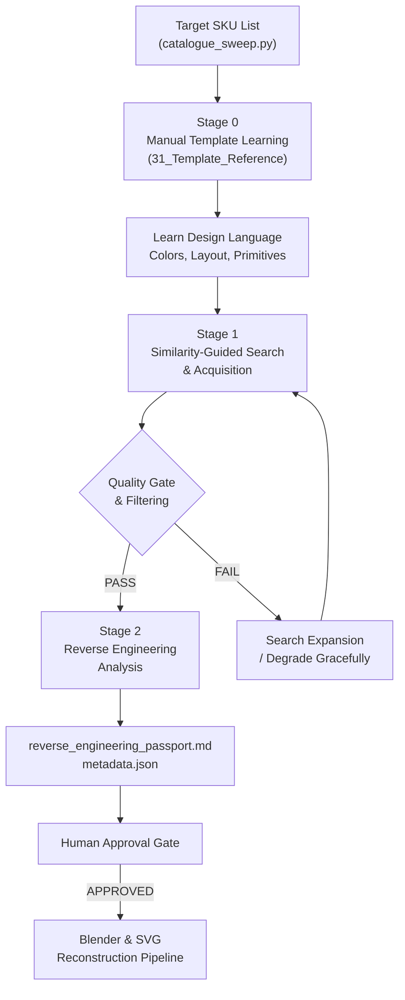

# SAAT — Target Reference Sweep & Reverse Engineering Passport Analyzer

> **Skill version:** 0.2 (Reverse Engineering Passport Architecture)
> **Upstream dependency:** `scripts/catalogue_sweep.py` (SKU list authority)
> **Downstream consumers:** Blender render driver, SVG vector generator, UV layout builder, QA verifier

---

## 1. Overview & Goal

**SAAT** (Searching and Analysis Templates) executes a deterministic, two-stage pharmaceutical packaging acquisition and visual reverse engineering workflow:

1. **Reference Gathering & Visual Learning** — acquires high-resolution pharmaceutical packaging photography for target SKUs, guided by visual design similarity learned from reference templates.
2. **Reverse Engineering Passport Generation** — reverse-engineers each reference image set into a machine-readable **Reverse Engineering Passport** (`reverse_engineering_passport.md`).

### Purpose

The Reverse Engineering Passport serves as the **Single Source of Truth (SSOT) technical specification** for package reconstruction. Unlike descriptive documentation, the passport provides precise, machine-readable visual geometry, layer stacks, primitive vector decompositions, normalized bounding boxes, typography geometry, color zones, and material shader parameters.

This document contains sufficient technical detail for downstream AI agents or procedural pipelines to reconstruct the packaging in 3D (Blender) or 2D (SVG/UV maps) without requiring access to the original photograph.

### Relationship to the PharmaGen PRO Pipeline

| Pipeline Stage | What SAAT Provides |
|---|---|
| **Before Stage 1** | Curated reference photographs and visual ground truth |
| **Stage 2 (Blender / Vector)** | The `reverse_engineering_passport.md` becomes the authoritative contract for 3D mesh building, UV mapping, shader materials, and text placement |
| **Post-Render QA** | Measurable bounding boxes and color zones provide numerical baselines for render verification |

### Inputs

| Input | Source | Authority |
|---|---|---|
| Target SKU List | `scripts/catalogue_sweep.py` → `GROUPS` dict | **SSOT** — the only list of SKUs processed |
| Visual Benchmark | `Reference Templates/31_Template_Reference/` | Visual ground truth for design language learning |
| SKU Metadata | `04_passports/passports_json/*.json` | Product names, dosage, template routing |
| SSOT Registry | `03_knowledge_graph/SKU.csv` | Package types, unit counts |

### Outputs

| Output | Location | Consumer |
|---|---|---|
| Curated Reference Images | `Reference Templates/<ID>_<Template_Name>/raw_*.png` | Computer vision, optical analysis |
| Reverse Engineering Passport | `Reference Templates/<ID>_<Template_Name>/reverse_engineering_passport.md` | Blender driver, SVG generator, UV builder |
| Machine Metadata | `Reference Templates/<ID>_<Template_Name>/metadata.json` | Pipeline orchestrator, QA verifier |

> **Краткое описание (RU):**
> SAAT извлекает технические параметры упаковки из фотографий и создаёт **Паспорт Обратного Проектирования** (`reverse_engineering_passport.md`). Паспорт содержит нормализованные координаты (bounding boxes), примитивы для SVG, векторные кривые, порядок слоёв (Layer Stack), сетку (Design Grid), геометрию шрифтов и зоны материалов для автоматического воссоздания упаковки в Blender и SVG.

---

## 2. Mandatory Observation Rules

Every visual fact, measurement, and inference inside the Reverse Engineering Passport MUST explicitly state its observation classification and confidence level. Silent assumptions or ungrounded assertions are strictly forbidden.

### Classification Categories

1. **`[Observed]`** — Directly visible and verifiable in the reference image pixels.
2. **`[Measured]`** — Geometrically measured or calculated from pixel coordinates / OCR bounding boxes.
3. **`[Estimated]`** — Inferred visual parameter based on perspective reconstruction or domain rules. Must include explicit confidence (`High`, `Medium`, `Low`).
4. **`[Unknown]`** — Visual data is hidden, occluded, or unavailable. Must be documented as a reconstruction constraint.

### Example Syntax

```markdown
- Brand Name Bounding Box: [Measured] x=0.070, y=0.250, w=0.520, h=0.180 (Confidence: High)
- Corner Radius: [Estimated] 0.8mm (Confidence: Medium — derived from 3/4 perspective curve)
- Rear Panel Layout: [Unknown] Occluded in reference set
```

---

## 3. Workflow Architecture



---

## 4. Stage 0 — Manual Template Learning

Before any automated search or secondary processing begins, the workflow MUST execute Stage 0 learning on the manually prepared reference template (`Reference Templates/31_Template_Reference/` or `31_T1_Kamagra`):

1. **File Normalization:** Automatically rename input photographs to standard view-based conventions (`raw_01_front.png`, `raw_02_angle_left.png`, etc.).
2. **Visual Feature Extraction:** Extract design language, color distribution, typography scale, graphic primitives, and layout grid from the manual template.
3. **Ground Truth Benchmark:** Generate the master benchmark `reverse_engineering_passport.md`.
4. **Search Orientation:** Feed learned visual parameters into the similarity search engine to guide subsequent internet queries.

---

## 5. Stage 1 — Reference Gathering & Similarity Search

### 5.1 Similarity-Driven Search Policy

Internet search is guided by **visual design equivalence** learned in Stage 0, not solely by textual product names:

- **Visual Query Matching:** Compare candidate images against learned color distribution, layout grid, typography weight, and package proportions.
- **Search Expansion:** For every SKU, automatically query for:
  - Front package face
  - Left isometric angle
  - Right isometric angle
  - Rear panel
  - Top & bottom flaps
  - Open packaging & inserts
  - Blister packs / Bottles / Tablets / Capsules
  - Different dosage & volume variants
  - Manufacturer, distributor, and regulatory documentation

### 5.2 High-Value Sources

Acquisition prioritizes authentic, high-resolution pharmaceutical photography. Approved high-value source categories include:

- Official pharmaceutical manufacturer websites & product portals
- Regulatory agency databases (FDA / DailyMed, EMA, MHRA)
- Pharmacy chains & licensed online pharmacies (e.g., Superdrug Online Doctor)
- Official pharmaceutical distributors & wholesalers
- Package insert databases & manufacturer PDF documentation

Representative approved reference sources:
- `https://onlinedoctor.superdrug.com/viagra.html`
- `https://kamagra-original.eu/en/sildenafil/kamagra-oral-jelly/`

### 5.3 Duplicate & Quality Filtering

Candidate images must pass deterministic quality gates:
- Minimum resolution: 800px on longest edge (preferred $\ge 1200\text{px}$).
- Reject watermarked images covering $>20\%$ of package surface.
- Reject screenshots with browser chrome or UI overlays.
- Reject heavy JPEG compression artifacts or motion blur.
- Deduplicate byte-identical or mirror-flipped images.

---

## 6. Stage 2 — Reverse Engineering Passport Specification

The output file `reverse_engineering_passport.md` MUST contain the following 12 technical chapters.

---

### Section A. Camera Reconstruction

Reconstruct the virtual camera parameters from perspective cues in the reference image to enable exact Blender camera matching:

| Parameter | Unit / Format | Status | Example |
|---|---|---|---|
| Estimated Camera Distance | Meters ($m$) | `[Estimated]` | 0.85 m |
| Pitch ($\theta_x$) | Degrees ($^\circ$) | `[Measured]` | 12.5° |
| Yaw ($\theta_y$) | Degrees ($^\circ$) | `[Measured]` | -35.0° |
| Roll ($\theta_z$) | Degrees ($^\circ$) | `[Measured]` | 0.0° |
| Equivalent Focal Length | Millimeters ($mm$) | `[Estimated]` | 85.0 mm |
| Field of View (FOV) | Horizontal Degrees | `[Estimated]` | 28.5° |
| Projected Front Face Aspect | Width:Height Ratio | `[Measured]` | 2.20 : 1 |
| Vanishing Point 1 ($VP_x$) | Normalized $(x,y)$ | `[Measured]` | (-2.45, 0.12) |
| Vanishing Point 2 ($VP_y$) | Normalized $(x,y)$ | `[Measured]` | (1.85, 0.08) |

---

### Section B. Bounding Boxes

Define normalized 2D bounding boxes ($x, y, w, h \in [0.0, 1.0]$) for every visible graphic, text, and structural element on the primary front panel:

```markdown
- OBJ_01_LOGO: [Measured] x=0.070, y=0.080, w=0.220, h=0.100 (Confidence: High)
- OBJ_02_BRAND_TITLE: [Measured] x=0.070, y=0.250, w=0.550, h=0.180 (Confidence: High)
- OBJ_03_ACTIVE_INGREDIENT: [Measured] x=0.070, y=0.500, w=0.480, h=0.080 (Confidence: High)
- OBJ_04_DOSAGE_STRENGTH: [Measured] x=0.070, y=0.780, w=0.200, h=0.100 (Confidence: High)
- OBJ_05_UNIT_COUNT: [Measured] x=0.720, y=0.780, w=0.200, h=0.080 (Confidence: High)
- OBJ_06_ACCENT_STRIPE: [Measured] x=0.000, y=0.940, w=1.000, h=0.060 (Confidence: High)
```

---

### Section C. Primitive Decomposition

Decompose all non-text graphical elements into geometric primitives for SVG vector reconstruction:

| Primitive ID | Type | Geometric Specification | Fill / Stroke | Layer |
|---|---|---|---|---|
| PRIM_01 | Rectangle | `x=0.0, y=0.94, w=1.0, h=0.06, rx=0` | Fill: `#00A859` | Layer 02 |
| PRIM_02 | Rounded Rectangle | `x=0.75, y=0.05, w=0.20, h=0.15, rx=0.02` | Fill: `#003366` | Layer 03 |
| PRIM_03 | Circle | `cx=0.85, cy=0.80, r=0.04` | Fill: `#D4AF37` | Layer 04 |
| PRIM_04 | Bezier Curve | `P0=(0.0,0.5), P1=(0.3,0.4), P2=(0.7,0.6), P3=(1.0,0.5)` | Stroke: `#003366`, 2px | Layer 03 |
| PRIM_05 | Polygon | `pts=[(0.0,0.9),(0.2,0.85),(0.2,0.9)]` | Fill: `#6B2D5C` | Layer 02 |

---

### Section D. Curve Reconstruction

Specify parametric descriptions for curved lines, wave patterns, or brand arcs:

```markdown
- CURVE_01 (Accent Arc):
  - Type: Cubic Bezier
  - Start Point: [Measured] (0.000, 0.450)
  - Control Point 1: [Estimated] (0.250, 0.400)
  - Control Point 2: [Estimated] (0.750, 0.500)
  - End Point: [Measured] (1.000, 0.450)
  - Stroke Thickness: [Measured] 0.008 (relative to height)
  - Continuity: C2 Smooth
  - Confidence: High
```

---

### Section E. Layer Stack (Z-Ordering)

Define the exact drawing order from background to foreground to ensure correct SVG and UV texture compilation:

```text
Layer 01 [Bottom]: Substrate Background (White #FFFFFF)
Layer 02: Background Graphical Blocks & Diagonal Gradients
Layer 03: Primary Accent Bands & Full-Width Stripes (#00A859)
Layer 04: Brand Badge & Geometry Overlays (#003366)
Layer 05: Manufacturer Logo Graphic (`ajanta`)
Layer 06: Primary Brand Typography (`KAMAGRA`)
Layer 07: Secondary Text (Active Ingredient `Sildenafil Citrate Tablets`)
Layer 08: Technical Annotations (Dosage `100 mg`, Unit Count `4 Tablets`)
Layer 09 [Top]: Holographic Security Seal / Foil Overlay
```

---

### Section F. Design Grid

Extract the underlying structural alignment system:

| Grid Parameter | Normalized Value | Observation |
|---|---|---|
| Left Margin ($u_{min}$) | 0.070 | `[Measured]` Strict left alignment for brand, ingredient, dosage |
| Right Margin ($u_{max}$) | 0.930 | `[Measured]` Right alignment boundary for unit count & badges |
| Top Margin ($v_{min}$) | 0.080 | `[Measured]` Manufacturer logo top offset |
| Bottom Margin ($v_{max}$) | 0.940 | `[Measured]` Top of bottom accent stripe |
| Column Count | 12-Column Grid | `[Estimated]` Elements snap to 1/12th grid increments |
| Primary Baseline $v_1$ | 0.250 | `[Measured]` Brand title baseline |
| Secondary Baseline $v_2$ | 0.500 | `[Measured]` Active ingredient baseline |
| Tertiary Baseline $v_3$ | 0.780 | `[Measured]` Dosage and unit count shared baseline |

---

### Section G. Typography Geometry

Provide complete spatial typography parameters for every text block:

| Text ID | String | Font Family (Estimated) | Weight | Case | Baseline ($v$) | Cap Height (% face) | Tracking | Alignment |
|---|---|---|---|---|---|---|---|---|
| TXT_01 | `KAMAGRA` | DejaVu Sans / Helvetica | Extra Bold | ALL CAPS | 0.250 | 18.0% | +0.02 | Left |
| TXT_02 | `Sildenafil Citrate Tablets` | DejaVu Sans / Arial | Medium | Title Case | 0.500 | 8.0% | 0.00 | Left |
| TXT_03 | `100 mg` | DejaVu Sans / Helvetica | Bold | Mixed | 0.780 | 10.0% | -0.01 | Left |
| TXT_04 | `4 Tablets` | DejaVu Sans / Arial | Regular | Title Case | 0.780 | 8.0% | 0.00 | Right |

---

### Section H. Color Zones

Segment the package into non-overlapping color polygons:

| Zone ID | Polygon Boundary (Normalized Vertices) | Dominant HEX | RGB | Surface Area % | Adjacent Zones |
|---|---|---|---|---|---|
| ZONE_01 | `(0,0)-(1,0)-(1,0.94)-(0,0.94)` | `#FFFFFF` | (255,255,255) | 88.5% | ZONE_02, ZONE_03 |
| ZONE_02 | `(0,0.94)-(1,0.94)-(1,1.0)-(0,1.0)` | `#00A859` | (0,168,89) | 5.5% | ZONE_01 |
| ZONE_03 | `(0.75,0.05)-(0.95,0.05)-(0.95,0.20)-(0.75,0.20)` | `#003366` | (0,51,102) | 6.0% | ZONE_01 |

---

### Section I. Material Zones

Map surface finish and shader characteristics across the carton:

| Zone ID | Target Area | Surface Finish | Roughness | Metallic | Clearcoat / Foil | Confidence |
|---|---|---|---|---|---|---|
| MAT_01 | Main Carton Body | Matte Cardboard | 0.70 | 0.00 | 0.00 | `[Measured]` High |
| MAT_02 | Brand Title (`KAMAGRA`) | Spot UV Gloss | 0.20 | 0.00 | 0.80 | `[Estimated]` Medium |
| MAT_03 | Security Dot | Holographic Foil | 0.05 | 1.00 | 0.00 (Aniso: 0.8) | `[Measured]` High |

---

### Section J. Relative Measurements

Document spatial ratios relative to total package dimensions:

- Logo Height Ratio: `[Measured]` 10.0% of front face height
- Brand Title Height Ratio: `[Measured]` 18.0% of front face height
- Accent Stripe Height Ratio: `[Measured]` 6.0% of front face height
- Accent Stripe Area Share: `[Measured]` 5.5% of total front face area
- Top-Right Badge Width Ratio: `[Measured]` 20.0% of front face width

---

### Section K. Visual Hierarchy

- **Primary Focal Point:** Brand Title (`KAMAGRA`) — highest contrast, largest cap height (18%).
- **Secondary Focal Point:** Dosage Strength (`100 mg`) + Accent Stripe (`#00A859`).
- **Reading Order:** Top-Left Logo $\to$ Center Brand Title $\to$ Subtitle INN $\to$ Bottom Dosage & Quantity.
- **Visual Balance:** Asymmetric left-heavy text column balanced by top-right brand badge.
- **Whitespace Ratio:** `[Measured]` 62.0% negative space on front face.

---

### Section L. Reconstruction Constraints

Explicitly log occluded, missing, or uncertain package regions:

```markdown
- CONSTRAINT_01: Top closure flap is occluded in 3/4 reference images. (Flap geometry inferred from RTE standard).
- CONSTRAINT_02: Rear panel prescribing text is unavailable in current reference set.
- CONSTRAINT_03: Side panel barcode numerical string is partially blurred (Code 128 structure confirmed, string inferred from passport sku_id).
```

---

## 7. Machine Readability & Output Schema

The `reverse_engineering_passport.md` file MUST be written in structured Markdown with strict table structures, code blocks, and normalized numerical values.

Corresponding machine metadata is stored in `metadata.json`:

```json
{
  "sku_id": "31_T1_Kamagra",
  "artifact_type": "reverse_engineering_passport",
  "schema_version": "2.0",
  "camera_reconstruction": {
    "pitch_deg": 12.5,
    "yaw_deg": -35.0,
    "focal_length_mm": 85.0
  },
  "bounding_boxes": {
    "brand_title": [0.07, 0.25, 0.55, 0.18],
    "dosage": [0.07, 0.78, 0.20, 0.10]
  },
  "color_zones": [
    {"id": "ZONE_01", "hex": "#FFFFFF", "area_pct": 88.5},
    {"id": "ZONE_02", "hex": "#00A859", "area_pct": 5.5}
  ],
  "quality_gate": {
    "reverse_engineering_passport_present": true,
    "bounding_boxes_complete": true,
    "primitives_decomposed": true,
    "layer_stack_defined": true
  },
  "status": "complete"
}
```

---

## 8. Quality Gates & Human Approval Gate

A SKU folder is complete only when:

1. `raw_*.png` references meet resolution and view requirements.
2. `reverse_engineering_passport.md` exists, is non-empty, and satisfies all 12 chapters (Sections A–L).
3. Every observation is tagged with `[Observed]`, `[Measured]`, `[Estimated]`, or `[Unknown]`.
4. `metadata.json` is updated with schema version `2.0`.
5. **Human Approval Gate:** Execution stops after passport generation and waits for explicit user confirmation before initiating downstream 3D/vector rendering passes.

---

## Appendix — Terminology Glossary

| Term | Technical Meaning |
|---|---|
| Reverse Engineering Passport | Machine-readable SSOT contract (`reverse_engineering_passport.md`) containing precise geometric, layer, primitive, and shader specifications |
| Normalized Coordinates | $(x, y, w, h)$ values scaled to $[0.0, 1.0]$ relative to the package face dimensions |
| Primitive Decomposition | Vector representation of graphics as Rectangles, Circles, Polygons, and Bezier Curves for SVG creation |
| Layer Stack | Z-indexed order of visual elements from bottom substrate to top holographic overlay |
| Design Grid | $u,v$ normalized alignment lines, margins, and text baselines |